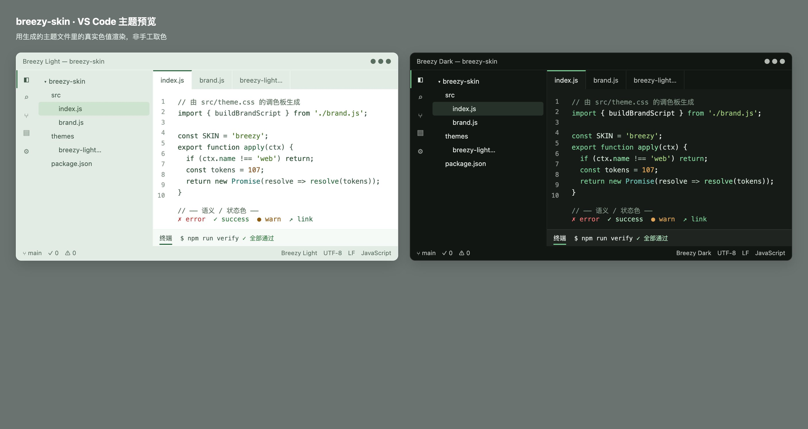

# Workbuddy Breezy — VS Code 主题

把 [breezy-skin](https://github.com/snap-idea/dsh-breezy-skin) 的亮 / 暗配色做成两个 VS Code 主题。

| 主题 | uiTheme | 文件 |
|---|---|---|
| **Workbuddy Breezy Light** | `vs` | `themes/breezy-light-color-theme.json` |
| **Workbuddy Breezy Dark** | `vs-dark` | `themes/breezy-dark-color-theme.json` |



## 安装

### 方式一：直接放进扩展目录

```bash
git clone git@github-snap-idea:snap-idea/vscode-breezy-theme.git
cp -R vscode-breezy-theme ~/.vscode/extensions/snap-idea.breezy-skin-theme-0.1.0
```

然后 `Cmd+Shift+P` → **Developer: Reload Window**。

### 方式二：打包成 vsix

```bash
npx @vscode/vsce package
code --install-extension breezy-skin-theme-0.1.0.vsix
```

### 方式三：开发模式

```bash
code --extensionDevelopmentPath="$PWD"
```

## 选择主题

`Cmd+K Cmd+T`，或 `Cmd+Shift+P` → **Preferences: Color Theme**：

- `Workbuddy Breezy Light`
- `Workbuddy Breezy Dark`

## 配色从哪来

色值不手工维护，而是从同项目的 DSH 皮肤**导出的快照** `palette.json` 生成：

```
dsh-breezy-skin/src/theme.css
        │  scripts/export-palette.py
        ▼
palette.json  ──►  scripts/gen-theme.py  ──►  themes/*.json
```

`palette.json` 是快照，**不要手改** —— 改色请回
[dsh-breezy-skin](https://github.com/snap-idea/dsh-breezy-skin) 改调色板，
重新导出后覆盖过来。

| 角色 | 亮色 | 暗色 |
|---|---|---|
| 编辑器底 | `#ffffff` | `#171b18` |
| 侧栏 / 活动栏 / 状态栏 | `#e3ece4` | `#121613` |
| 面板 / 分层面 | `#f5faf6` | `#1f2420` |
| 浮层（菜单 / 下拉 / 通知） | `#fcfefc` | `#282d29` |
| 正文 | `#2f4938e6` | `#e0e9e2e6` |
| 次要文字 | `#2f4938c5` | `#e0e9e2c5` |
| 主色 | `#2e6943` | `#79cd94` |
| 列表选中 | `#cee3d0` | `#26312a` |
| 描边 | `#eff6f0` / `#dbeadd` | `#e0e9e214` / `#e0e9e233` |

列表选中色 `#cee3d0` 和 DSH 皮肤里的侧栏会话选中完全一致。

## 生成与校验

```bash
npm run gen      # palette.json → themes/*.json
npm run audit    # 色值格式 / color ID 覆盖 / 对比度
npm run verify   # 两者都跑
```

生成器三层映射：

1. **结构色显式映射** —— 编辑器、侧栏、状态栏、标签页、列表、边框、文字阶
2. **主色替换** —— 默认主题里以 `#0069CC` 为代表的蓝色系整体换成本主题的绿
3. **中性色统一染色** —— 其余低色度色统一到品牌色相（OKLCH），保证整屏一个色族

骨架取自 VS Code 自带的 `2026-light` / `2026-dark`（含 `include` 链合并后
light 393 / dark 376 个 color ID），因此**默认主题的每个 color ID 都有值**，
不会出现组件退回内置色。

## 可访问性

`npm run audit` 校验 39 组文字/背景配对 + 16 个语法 token，全部达到：

- 正文类 **4.5:1**（WCAG AA）
- 非文字 UI（图标、行号、面包屑）**3.0:1**（SC 1.4.11）

亮色注释色 `#5f7362`（5.10:1）、暗色注释色 `#7d9182`（5.18:1）都是为达标专门调的 ——
常见主题把注释压到 3:1 左右，这里没有。

## 踩过的坑（改之前先看）

**VS Code 主题色值只接受 `#RGB` / `#RGBA` / `#RRGGBB` / `#RRGGBBAA`。**

不要写 `rgba(224, 233, 226, 0.08)` —— 它解析不了，会回退成一个完全不相干的颜色。
曾经在 `widget.border` 上这么写过，结果命令面板外框被渲染成 `#d31411` 纯红，
暗色 33 个边框键全部受影响。

生成器里的 `to_vscode_color()` 会把 `rgba()` 折成 8 位 hex，遇到不认识的格式直接抛异常；
审计脚本也只认 hex。两道闸都在，别绕过。

## 已知取舍

- **不是每屏都绿**：只把中性面染色，语义色（错误红、警告琥珀、成功绿）保留色相，
  否则报错和提示会分不清。
- **语法高亮是自然系**：绿 / 青 / 琥珀三族，靠明度和字重区分角色，没有引入紫色、
  品红等与主题冲突的色相。代价是配色比多彩主题收敛。
- **暗色不是纯黑**：编辑器底 `#171b18`，沿用 DSH 皮肤的抬升梯。

## 授权

MIT
